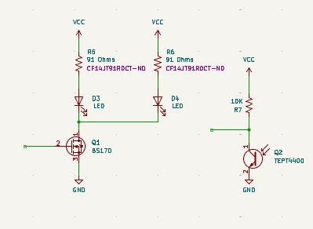

# GS_Circuit

LED night-light for GSA activity

## Notes from aftermath of 2026

### Hardware

* Light sensor wired incorrectly:
   Collector should go to +5V
   Emitter should go through 10k resistor to GND
* Light sensor needs to go to an ADC pin.  This is tricky as there are so few pins.
  
Here is the table of ATTiny85 pins:

|            Other | GPIO | # | # | GPIO | Other           |
|-----------------:|------|---|:--|------|-----------------|
| nRST/<b>ADC0</b> | PB5  | 1 | 8 |      | VCC             |
|      <b>ADC3</b> | PB3  | 2 | 7 | PB2  | SCK/<b>ADC1</b> |
|      <b>ADC2</b> | PB4  | 3 | 6 | PB1  | MISO            |
|              GND |      | 4 | 5 | PB0  | MOSI            |
|                  |      |   |   |      |                 |

We need to avoid pins 5, 6, 7 and 1 if we want to use ISP.
 That leaves 2, 3 as ADC pins.  Those are used for LEDs to avoid conflict with the ISP.
 So no obvious solution, as the LEDs and light sensor cannot share pins with the ISP.

Propose to add 1 or 2 BS170 MOSFETs to drive the LEDs.  Then these
pins can share the ISP pins with no problem.

See below for proposed circuit changes.  One might want a pull-down
on the MOSFET gate(s).

